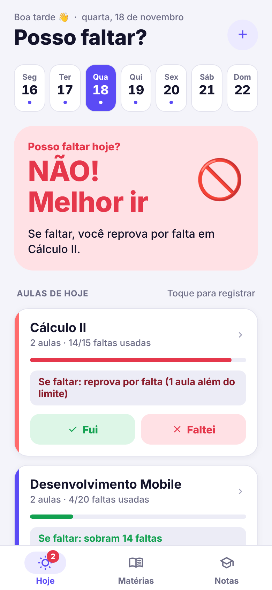
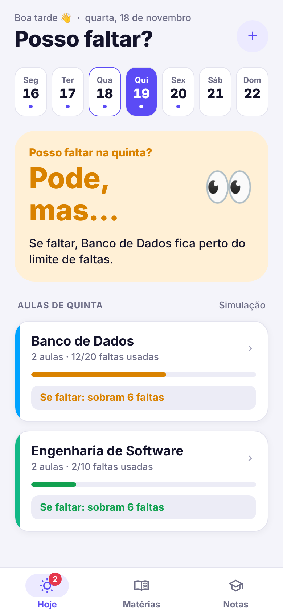
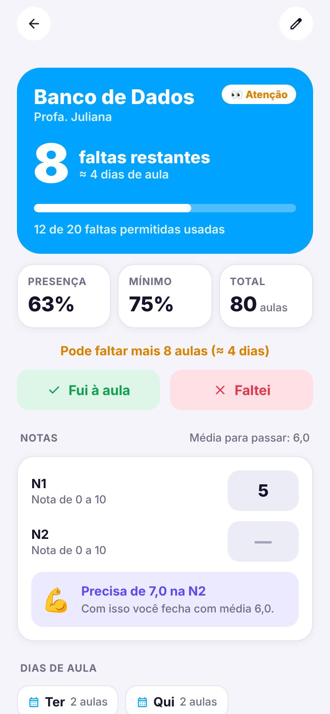

<p align="center">
  
</p>

<h1 align="center">Posso Faltar?</h1>

<p align="center">
  Controle de faltas e notas da faculdade.<br/>
  Descubra, num toque, se dá pra faltar <b>sem reprovar</b>.
</p>

<p align="center">
  
  
  
  
</p>

## 🎬 Vídeo de demonstração

<p align="center">
  <a href="docs/demo.mp4">
    
  </a>
</p>

<p align="center"><a href="docs/demo.mp4"><b>▶️ Assistir ao vídeo (29 s)</b></a></p>

## O problema

Todo semestre tem aluno que reprova **por falta**, e não por nota. A maioria das faculdades exige
**75% de presença**, mas quase ninguém sabe de cabeça quantas faltas ainda pode ter em cada matéria.
O controle fica espalhado entre o portal do aluno (que atualiza com atraso), o caderno e a memória.
O mesmo vale para as notas: *"quanto eu preciso tirar na N2 pra passar?"*.

## A solução

Um app simples que responde à pergunta que todo estudante faz:

> **"Posso faltar hoje?"** → **SIM, pode!** 😎 / **Pode, mas…** 👀 / **NÃO! Melhor ir** 🚫

### Funcionalidades

| | |
|---|---|
| ☀️ **Hoje** | Veredito do dia com base em todas as matérias que você tem naquele dia. Dá para tocar em qualquer dia da semana e **simular** ("posso faltar na quinta?"). |
| ✅ **Registro em 1 toque** | Botões **Fui** / **Faltei** em cada aula do dia. Tocar de novo desfaz. A aba mostra quantas aulas faltam marcar. |
| 📚 **Matérias** | Resumo colorido do semestre (tranquilo, atenção, no limite, reprovado) e, por matéria, quantas faltas ainda pode ter, em **aulas e em dias**. |
| 🔎 **Detalhe da matéria** | Faltas restantes, % de presença, histórico (com opção de apagar), registro em qualquer dia desde o começo do semestre (calendário por mês). |
| 🎓 **Notas** | Padrão da faculdade: N1 (até 4,5) + N2 (até 4,5) + PPD (até 1), média 6,75. Lance as notas e veja **em tempo real** quanto precisa tirar para passar, ou se já passou. |
| 🎨 **UI/UX** | Modo claro/escuro automático, vibração nos toques (haptics), ícones nativos (SF Symbols no iPhone e Material no Android), dados salvos no aparelho. |
| ✨ **Dados de exemplo** | Um toque carrega um semestre fictício para demonstrar o app. |

### Como o cálculo funciona

```
faltas permitidas = total de aulas × (100% − frequência mínima)
                    ex.: 80 aulas × 25% = 20 faltas

restantes         = faltas permitidas − faltas registradas
dias restantes    = restantes ÷ aulas por dia de aula

nota final        = soma dos pontos de todas as avaliações (N1 + N2 + PPD, até 10)
nota necessária   = média − pontos já feitos
                    ex.: N1 = 3,5, PPD = 1, média 6,75 → 6,75 − 4,5 = 2,25 na N2
```

Situação de cada matéria:

- 😎 **Tranquilo**: usou menos da metade das faltas.
- 👀 **Atenção**: usou 50% ou mais.
- 😬 **No limite**: usou 80% ou mais, ou não dá para faltar mais um dia inteiro.
- 💀 **Reprovado**: passou do limite.

## Como rodar no celular

Pré-requisitos: [Node.js LTS](https://nodejs.org) no computador e o app **Expo Go** no celular
([Android](https://play.google.com/store/apps/details?id=host.exp.exponent) /
[iPhone](https://apps.apple.com/app/expo-go/id982107779)), **atualizado** para a versão mais recente.

```bash
git clone https://github.com/cauagomesdev/posso-faltar.git
```

```bash
cd posso-faltar
```

```bash
npm install
```

```bash
npx expo start
```

Escaneie o QR Code que aparece no terminal: no Android pelo próprio Expo Go e no iPhone pela câmera.
O celular e o computador precisam estar **na mesma rede Wi-Fi**. Se a rede da faculdade bloquear,
use o túnel:

```bash
npx expo start --tunnel
```

Também dá para abrir no navegador apertando `w` no terminal.

### Comandos úteis

| Comando | O que faz |
|---|---|
| `npm start` | Inicia o servidor de desenvolvimento |
| `npm run lint` | Verifica o código (ESLint) |
| `npm run typecheck` | Verifica os tipos (TypeScript) |

## Tecnologias

- **React Native 0.88** + **Expo SDK 58** (roda no Expo Go, sem build nativo)
- **Expo Router**: navegação por arquivos, abas nativas (`NativeTabs`) e modais
- **TypeScript**
- **AsyncStorage**: dados salvos localmente no aparelho (funciona offline)
- **expo-symbols** (ícones) e **expo-haptics** (vibração)
- **React Compiler** ativado

## Estrutura do projeto

```
src/
├── app/                      # Telas (cada arquivo é uma rota)
│   ├── _layout.tsx           # Pilha de navegação + tema + provedor de dados
│   ├── (tabs)/
│   │   ├── index.tsx         # Hoje: "Posso faltar?"
│   │   ├── materias.tsx      # Lista de matérias e situação das faltas
│   │   └── notas.tsx         # Quanto falta pra passar
│   ├── materia/[id].tsx      # Detalhe da matéria
│   ├── materia/form.tsx      # Nova/editar matéria (modal)
│   └── registrar.tsx         # Registrar presença/falta em uma data (modal)
├── components/               # Componentes visuais reutilizáveis
├── constants/theme.ts        # Cores (claro/escuro), espaçamentos
├── hooks/                    # useTheme, usePendingToday...
└── lib/
    ├── calc.ts               # Regras: faltas, veredito do dia, notas
    ├── store.tsx             # Estado global + persistência
    ├── sample.ts             # Dados de exemplo
    └── dates.ts              # Datas em pt-BR
```

## Sobre o vídeo

O [vídeo de demonstração](docs/demo.mp4) (29 s, vertical 1080×1920, sem áudio) mostra o app
funcionando com os dados de exemplo, gravado da versão web numa moldura de celular:

| Tempo | Cena | Narração sugerida (se quiser gravar voz) |
|---|---|---|
| 0–2 s | Abertura com o ícone e o nome do app | — |
| 2–5 s | Tela **Hoje** responde "SIM, pode! 😎" | "Quantas vezes você ficou na dúvida: posso faltar hoje?" |
| 5–12 s | Simulação: quarta dá **NÃO!**, quinta dá **Pode, mas…**, domingo dá **Dia livre** | "O Posso Faltar? responde na hora e ainda simula outros dias." |
| 12–15 s | Toque em **Fui**: aula registrada | "Registrar presença é um toque." |
| 15–19 s | Aba **Matérias** e detalhe: "8 faltas restantes ≈ 4 dias" | "Cada matéria mostra quantas faltas ainda dá pra ter." |
| 19–23 s | Digitar a **N2**: de "Precisa de 3,75 em N2" para "Aprovado com 7,0 🎉" | "E calcula quanto você precisa tirar pra passar." |
| 23–26 s | Aba **Notas**: N1 + N2 + PPD de todas as matérias | "Tudo num lugar só." |
| 26–29 s | Encerramento | "Posso Faltar?: nunca mais reprove por falta." |

> Para gravar a tela do seu próprio celular: toque em **Ver com dados de exemplo** na primeira tela
> (ou cadastre suas matérias de verdade). Para recomeçar do zero, use **Apagar tudo e recomeçar** no
> fim da aba Matérias.

## Próximos passos (visão de produto)

- 🔔 Lembrete no horário da aula para marcar presença.
- 📲 Widget na tela inicial com o veredito do dia.
- 🏫 Importar a grade direto do portal do aluno.
- 👥 Compartilhar com a turma: "quem vai na aula hoje?".
- 💎 Versão premium: múltiplos semestres, backup na nuvem e estatísticas.

---

Projeto desenvolvido para a AT2-N2 (Desenvolvimento de Aplicativo Mobile), com auxílio de um agente
de IA (Claude Code) na prototipação, no código e nos testes.
